  

  
  
  
  

  

I'm a computer science student who builds security tools to understand how they work: packet sniffers, encryption utilities, and authentication flows. Right now I'm digging into low-level systems and automating security work.

## Stack

  

## Projects

| Project | What it does | Area |
| :--- | :--- | :--- |
| **[NETWORK_SNIFFER](https://github.com/BBPranav-commits/NETWORK_SNIFFER)** | Captures packets and inspects network traffic. | Network security |
| **[SecureLogin](https://github.com/BBPranav-commits/SecureLogin)** | Authentication workflow with secure credential handling. | Application security |
| **[PasswordStrengthAnalyser](https://github.com/BBPranav-commits/PasswordStrengthAnalyser)** | Scores password entropy and flags weak patterns. | Application security |
| **[ImageEncrypter](https://github.com/BBPranav-commits/ImageEncrypter)** | Encrypts and decrypts image files. | Cryptography |
| **[CaeserCipherEncrypter](https://github.com/BBPranav-commits/CaeserCipherEncrypter)** | Classic substitution cipher for text. | Cryptography |
| **[Keylogger](https://github.com/BBPranav-commits/Keylogger)** | Educational script demonstrating how input monitoring works. | Security research |
| **[HotelBookingSystem](https://github.com/BBPranav-commits/HotelBookingSystem)** | Hotel reservation and room management. | Software engineering |

## Activity

  
  

  

  <picture>
    <source media="(prefers-color-scheme: dark)" srcset="https://raw.githubusercontent.com/BBPranav-commits/BBPranav-commits/output/github-snake-dark.svg">
    
  </picture>

  

